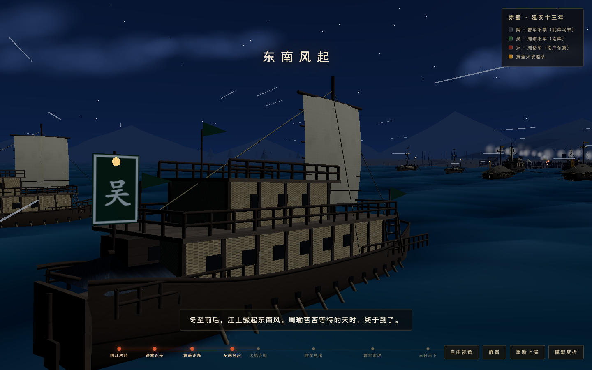
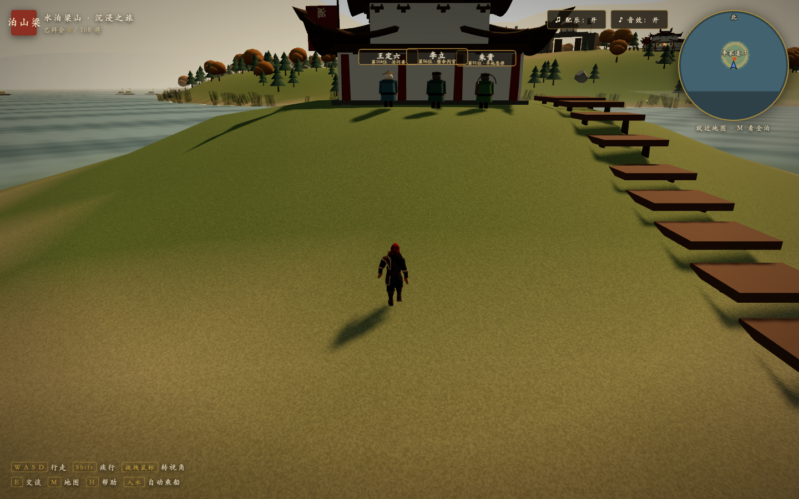
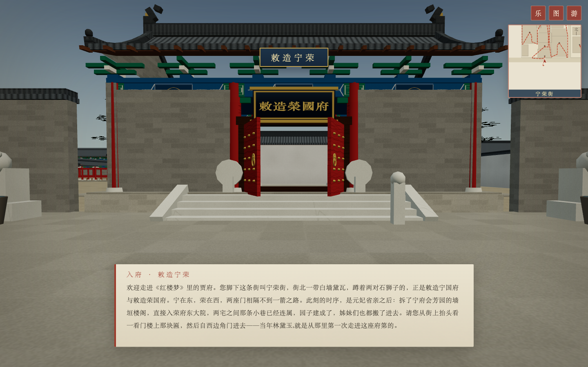
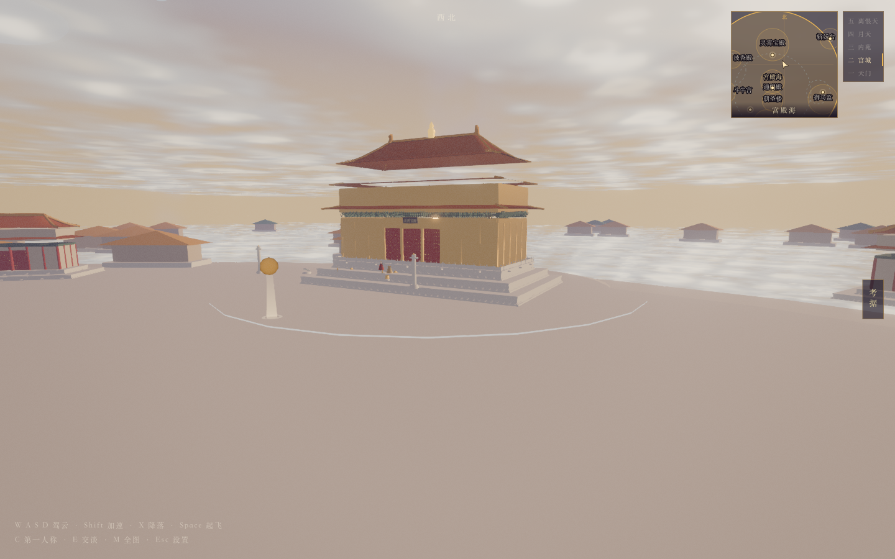
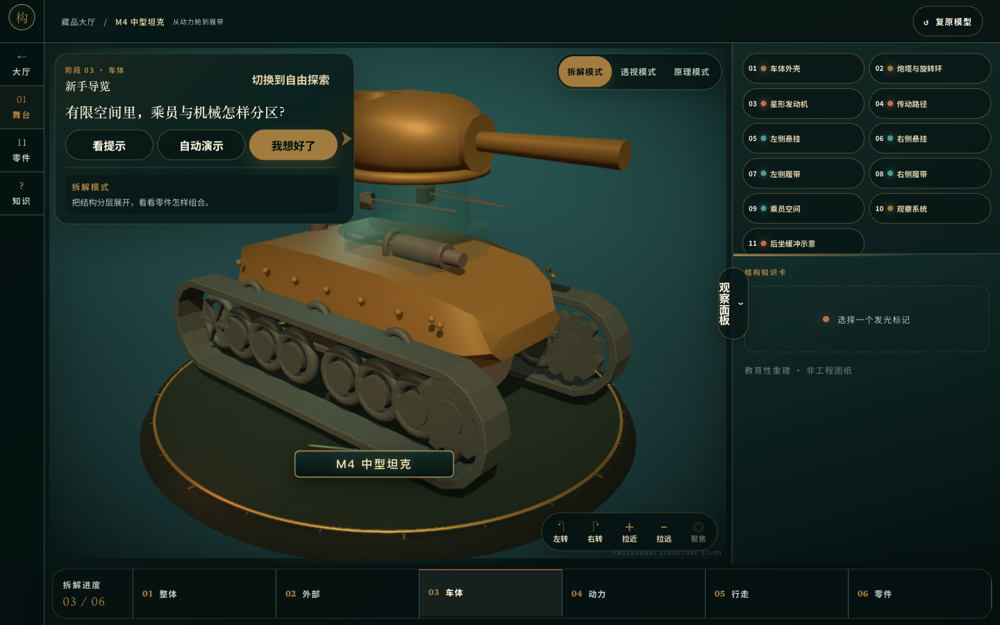
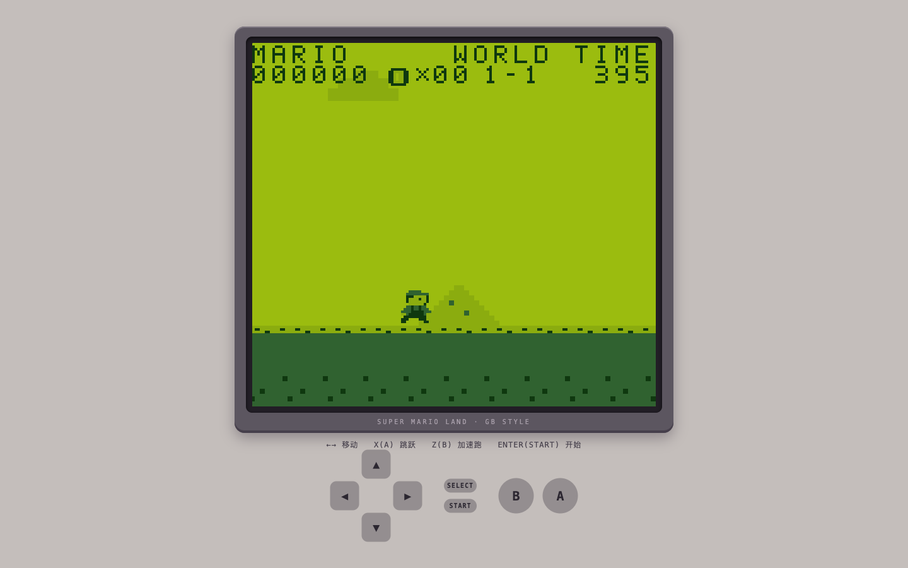
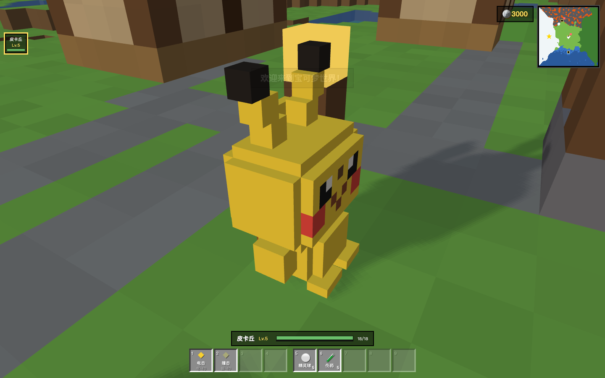
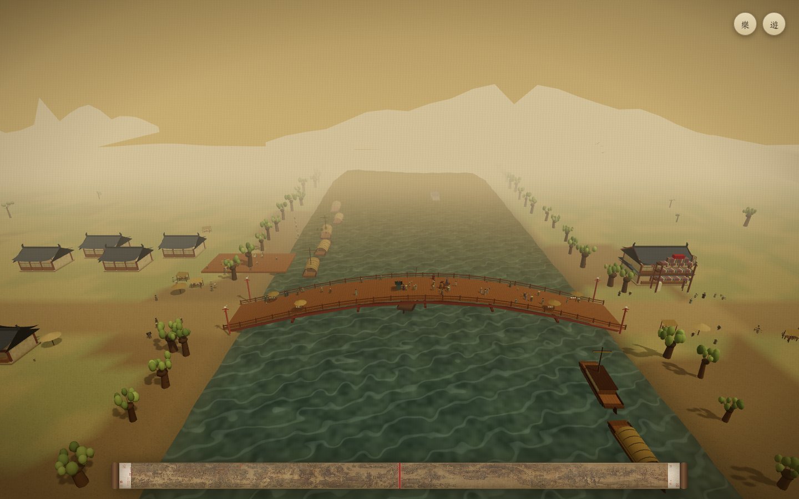
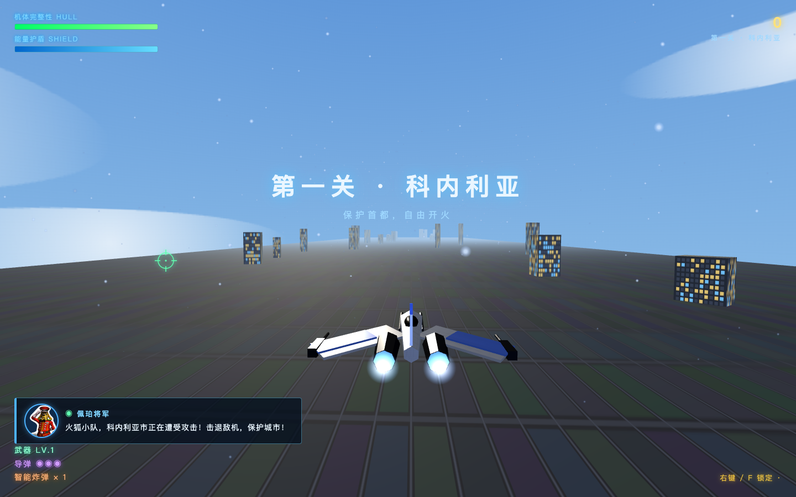

# Interactive Projects Collection

**English** | [简体中文](README.zh-CN.md)

Ten standalone browser projects with source code and existing runtime assets: explore literary worlds, play games, and discover history and mechanical principles. Most project interfaces are in Chinese.

| Project | Experience | How to run |
| --- | --- | --- |
| [Three Kingdoms](三国/) | A real-time 3D recreation of the Battle of Red Cliffs. | Static server → `/三国/` |
| [Water Margin](水浒传/) | Explore Liangshan Marsh and meet the heroes of Water Margin. | Static server → `/水浒传/` |
| [Grand View Garden](daguanyuan/) | Walk through the mansions and gardens of Dream of the Red Chamber. | Static server → `/daguanyuan/` |
| [Heavenly Palace](tiangong/) | Fly through the Heavenly Palace as the Monkey King. | Run `npm install` and `npm run dev` in this directory |
| [Mechanical Atlas](3d_structure/) | An interactive 3D exhibition of mechanical structures and principles. | Run `npm install` and `npm run dev` in this directory |
| [History: Mountains and Rivers](history/) | An interactive historical journey with timelines, maps, and media. | Static server → `/history/` |
| [GB / GBC Games](gb_game/) | A collection of browser games inspired by handheld classics. | Static server → `/gb_game/gb_game/` |
| [Pokémon Voxel World](pokemon_minecraft/) | Explore a block-built world with Pokémon-inspired adventures. | Static server → `/pokemon_minecraft/` |
| [Along the River](qingming_picture/) | Step into a 3D interpretation of Along the River During the Qingming Festival. | Static server → `/qingming_picture/` |
| [Star Strike](star_fox/) | A Star Fox-inspired 3D rail shooter. | Static server → `/star_fox/` |

GBC game entry: `/gb_game/gbc_game/03-zelda-links-awakening-dx.html`.

## Screenshots

Actual gameplay and application views captured in a local browser at 1440 × 900. These are running projects, not concept artwork.

### [Three Kingdoms](三国/)

A real-time 3D recreation of the Battle of Red Cliffs.



### [Water Margin](水浒传/)

Explore Liangshan Marsh and meet the heroes of Water Margin.



### [Grand View Garden](daguanyuan/)

Walk through the mansions and gardens of Dream of the Red Chamber.



### [Heavenly Palace](tiangong/)

Fly through the Heavenly Palace as the Monkey King.



### [Mechanical Atlas](3d_structure/)

An interactive 3D exhibition of mechanical structures and principles.



### [History: Mountains and Rivers](history/)

An interactive historical journey with timelines, maps, and media.


### [GB / GBC Games](gb_game/)

A collection of browser games inspired by handheld classics.



### [Pokémon Voxel World](pokemon_minecraft/)

Explore a block-built world with Pokémon-inspired adventures.



### [Along the River](qingming_picture/)

Step into a 3D interpretation of Along the River During the Qingming Festival.



### [Star Strike](star_fox/)

A Star Fox-inspired 3D rail shooter.



## Download

Choose **Code → Download ZIP** on GitHub, or clone this repository. The full collection is approximately 1.6 GB because it includes audio, models, videos, and 3D scenes. GitHub's compressed download size may differ.

## Run on Windows, macOS, or Linux

Node.js, Python, `node_modules`, and virtual environments are not bundled. Install the tools you need on your own computer. Normal gameplay does not require an API key; existing runtime media are included.

Most projects use ES Modules and need an HTTP server. Open them through a local server instead of double-clicking their HTML files.

From the collection root, choose one option:

```bash
# With Node.js installed (any platform)
npx --yes http-server . -p 8080 -c-1
```

```bash
# Windows, with Python installed
py -m http.server 8080
```

```bash
# macOS / Linux, with Python installed
python3 -m http.server 8080
```

Open `http://localhost:8080/` in your browser and select a project directory. Use a modern browser with WebGL support. Heavenly Palace uses WebGPU or WebGL depending on browser capabilities.

### Projects that need a build tool

`tiangong` and `3d_structure` are Vite projects. Install dependencies and start each project from its own directory; the terminal will display the local URL:

```bash
cd tiangong
npm install
npm run dev
```

Use the same commands inside `3d_structure` for Mechanical Atlas. Mechanical Atlas requires Node.js `^20.19.0 || >=22.12.0`. Each project's `package.json` and lockfile define its dependencies. Use `npm run build` to generate a production build.

## What is included

- Source code, project documentation, browser libraries, and existing runtime audio, images, videos, and models.
- No local API keys, credential files, environment-variable files, cloud-server operations notes, installed environments, caches, logs, or generation intermediates. The screenshots above are intentional documentation assets.
- The initial publication uses a fresh Git history rather than importing the original project histories.
- `history/productions` contains video-production projects and duplicate intermediate assets, so it is excluded. Videos used by the application remain under `history/assets`.
- Water Margin includes the Wusong model referenced by the code; duplicate generated models and intermediate exports are excluded.
- Three Kingdoms loads its required Three.js browser files from `三国/vendor/three`, with the Three.js license included. It does not need a bundled `node_modules` directory.

Audio-generation scripts are optional development tools. To regenerate media, configure your own service credentials. Local key files are excluded by `.gitignore`. Some original project documents refer to local credential paths; those credentials are not supplied.

Original documentation, source records, third-party licenses, and attribution notices remain in the individual project directories.
